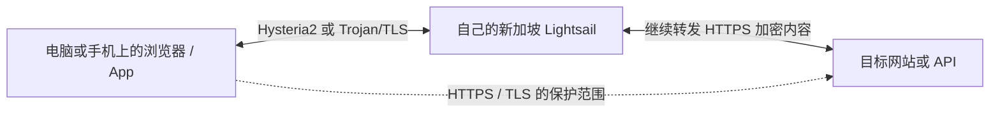

# 给 Agent 的新加坡 AWS 自用网络完整部署说明

版本 2026-10-25-public-v1。面向具备终端、浏览器或等效 AWS 工具的 Codex、WorkBuddy、Claude Code。文末四份完整 Python 代码是本文件的一部分，可以直接保存成同名文件。普通聊天模型没有执行工具时，应交付命令与检查结果，不能声称已部署。

## 先理解目标

账号所有者希望拥有一台自己管理的新加坡云服务器，用于个人或低并发小团队的加密网络连接。初始只创建一台 Lightsail Linux 公网 IPv4、$7/月基础套餐；服务器安全措施和客户端实际联网路径分别验收。达到参考案例的某个 Mbps 数字不属于保证。

参考案例曾记录到约 131 至 171 Mbps 的较快短时下载，也有更慢时段。320 Mbps 是客户端速率参数。参考案例中的 WireGuard 存在握手故障，本公开基线不启用它。

公开实现锁定 Ubuntu 24.04、sing-box 1.14.4、Certbot 5.8.0。它由原方案重新编写，经过本地语法、配置与模拟流程验证后交付，没有在第二台收费 AWS 实例上完成端到端部署。必须在新账号/新实例上按本文件验收，不得把作者历史测试改写为新部署的结果。

## 对执行 Agent 的硬性要求

1. 先读回账号、地区、套餐和现有资源，默认只查看计划。得到所有者对目标账号、$7基础月费和可能附加费用的明确批准后，才执行 `--apply`。批准同一范围后不要反复确认。
2. 账号所有者亲自完成 AWS 注册、付款/身份验证、MFA 和证书条款确认。不要索取长期 AWS Access Key、Secret Key、AI 密码、手机验证码、KYC 材料或银行卡信息。
3. 优先用 `aws login` 短期浏览器登录。IAM 身份需要对应的 SignInLocalDevelopmentAccess 和 Lightsail 权限；不要替所有者扩大权限。root 仅用于必要的账户初始化，后续使用受限管理身份。
4. 不为赠金加入 AWS Organizations、Control Tower 或 APN，不自动升级 Free plan 为 Paid plan，不购买快照、额外服务器、负载均衡器、NAT Gateway、域名或付费面板。
5. 本实现仅用于全新、专用 Ubuntu 24.04。遇到已有网站、占用端口、现成防火墙或未知部署标记，停止覆盖并解释原因。不要在账号中随便找一台现有服务器运行安装脚本。
6. 订阅 URL 等同密码。凭据只保存在权限受限文件中，不输出到聊天、截图、普通终端日志或公开仓库。命令失败时不要把完整配置或子进程输出贴出来。
7. TLS 证书验证必须开启。不能用自签证书加“跳过验证”来宣称完成；不能安装 HTTPS 解密根证书或开启 MITM。
8. 保留当前可用网络。先用独立非 TUN 进程验证。修改实际内核前必须有独立到期恢复；Mac 可用本文守护。这个守护只保护它自己发起的临时内核试用，不保护任意 GUI、系统代理开关或永久设置。
9. TUN、系统代理、普通浏览器和特定 App 不是同一种覆盖范围。规则没有 DIRECT 兜底，只说明已进入该内核的请求不自动直连；不能据此宣称整机 Kill Switch 已通过。
10. 只记录真实通过的项目。超时不代表防火墙一定拒绝，网页 403 不代表网速故障或账号被封，公开健康页正常不等于完整安全审计。

## 选择配置与核对费用

截至 2026-10-25，以下为 Linux 公网 IPv4 套餐基础月费，统一按 USD。不要把同名的 IPv6-only 档位混进来。

| 基础月费 | vCPU | 内存 | SSD | 月传输额度 | 适用起点 |
|---:|---:|---:|---:|---:|---|
| $5 | 2 | 0.5 GB | 20 GB | 1 TB | 更小的试验，有内存余量风险 |
| **$7** | **2** | **1 GB** | **40 GB** | **2 TB** | 本文基线 |
| $12 | 2 | 2 GB | 60 GB | 3 TB | 确认内存或并发成为瓶颈后再评估 |
| $24 | 2 | 4 GB | 80 GB | 4 TB | 更高负载，不应只为追分或赠金选它 |
| $44 | 2 | 8 GB | 160 GB | 5 TB | 不属于本次批准范围 |

[官方套餐表](https://docs.aws.amazon.com/lightsail/latest/userguide/amazon-lightsail-bundles.html)。实际创建前必须用当前区域 API 再读一次价格。帮助脚本只接受核对到的 $7 公网 IPv4、1 GB 套餐。

- 符合条件的新 AWS 客户注册后有 $100 抵扣金，可通过指定活动再赚最高 $100。过去曾有 AWS 账号的人不当然符合资格。
- Free plan 最长六个月或抵扣金耗尽时结束，以较早者为准。抵扣金通常自开户起十二个月到期。Free plan 到期而未转 Paid，资源不能继续正常使用。
- Paid plan 超出余额或不适用抵扣金的费用可以扣款。$100÷$7 不代表可免费使用十四个月。
- 两个方向的传输都计入额度；超额后只对需收费的外发流量计费。新加坡当前公开价 $0.12/GB。代理转发一次内容会经过服务器进出两段，不能把 2 TB 当成每台终端各有 2 TB。
- 静态 IPv4 绑定实例时不另计静态 IP 费；未绑定超过一小时可能 $0.005/小时。停止实例仍有实例费用。额外磁盘、快照、税费及软件/AI订阅另算。
- 设置账单与用量提醒，明确提醒不是硬性费用封顶。留意 Free plan 和抵扣金两个日期。

[账户计划](https://docs.aws.amazon.com/awsaccountbilling/latest/aboutv2/free-tier-plans.html) · [赠金资格](https://aws.amazon.com/free/free-tier-faqs/) · [流量口径](https://docs.aws.amazon.com/lightsail/latest/userguide/amazon-lightsail-faq-data-transfer-allowance.html) · [静态 IP 与计费](https://docs.aws.amazon.com/lightsail/latest/userguide/amazon-lightsail-frequently-asked-questions-faq-billing-and-account-management.html)

## 主流程与两层加密



主流程为账号检查、费用批准、新建一台专用服务器、绑定静态 IPv4、收窄云防火墙、要求 IMDSv2、安装官方软件、签发可信 IP 证书、生成设备凭据、独立测试、受保护试用，再逐终端验收。

网络隧道保护终端到 AWS；App 或浏览器自己的 HTTPS 通常保护到目标服务。AWS 单纯转发时不需要解开 AI 正文。如果另装 API 中转程序读取提示词，应重新评估该程序和日志权限。

固定机房 IP 并不等于住宅 IP，也不改变 AI 服务的账号资格、真实地区或使用规则。自建增加控制权，同时仍依赖 AWS、运营商、客户端和目标服务。

## 软件与端口

| 用途 | 协议与端口 | 范围 |
|---|---|---|
| IP 证书 ACME HTTP 验证 | TCP 80 | 公网，仅提供 challenge 文件，其余 404 |
| TLS 订阅与 Trojan/WebSocket | TCP 443 | 公网，可信证书 |
| Hysteria2 | UDP 51821 | 公网，独立设备密码、TLS |
| Trojan 内部后端 | TCP 10000 | **仅 127.0.0.1**，不开放云防火墙 |
| SSH | TCP 22 | 云端仅 `lightsail-connect` 浏览器来源 |
| Mihomo 客户端混合代理 | 默认 TCP 7890 | 仅本机 127.0.0.1 |
| 历史 WireGuard | UDP 51820 | 本公开基线不开放、不启用 |

当前作者老服务器曾通过 NAT 把 UDP 51821 转发到内部 8443、把 UDP 51820 转发到 443。这是历史结构。新部署直接让 Hysteria2 监听 UDP 51821，省去这层端口重定向。TCP 443 与 UDP 443 属于不同服务，数字相同也不能混为 HTTPS。

下载只用官方入口。

- [AWS CLI v2](https://docs.aws.amazon.com/cli/latest/userguide/getting-started-install.html)，`aws login` 需要 2.32.0 或更新。
- [Clash Verge Rev 官方发布](https://github.com/clash-verge-rev/clash-verge-rev/releases)，按 Windows/macOS 和芯片架构选择稳定版。它是客户端，不附带服务器。
- [Shadowrocket 正版 App Store](https://apps.apple.com/app/id932747118)，价格和上架情况以自己的商店区域为准；它也不附带代理服务。
- [sing-box 官方 1.14.4](https://github.com/SagerNet/sing-box/releases/tag/v1.14.4)，安装脚本校验 Linux 包 SHA256。
- [Certbot](https://certbot.eff.org/) 与 [Let's Encrypt IP 证书说明](https://letsencrypt.org/2026/03/11/shorter-certs-certbot/)。IP 证书有效约六天，需要自动续期及成功换证后的服务重载。

## 执行前只补齐真正缺失的信息

| 信息 | 获取方式 |
|---|---|
| AWS 账号与权限 | 优先从短期登录后的 STS 读回，由本人确认目标账号 |
| 区域 | 默认 `ap-southeast-1`，更换区域要重新看价格与路径 |
| 新实例名称 | 默认 `selfhost-sg-01`，若已存在则核对所有权，禁止覆盖陌生实例 |
| 证书联系邮箱 | 本人提供，用于证书服务联系；不需要邮箱密码 |
| 设备标签 | 如 `laptop-01,phone-01`，每个标签一套凭据，最多六台有效设备 |
| 基础费用批准 | 本人明确接受 $7/月基础费及实际附加费用规则 |
| ACME 条款 | 本人阅读并明确接受后，才允许使用 `--accept-acme-terms` |
| 所在网络与客户端 | 从本机状态核对，不能仅凭旧对话假设 |

## 保存代码与先看计划

把文末四份代码保存为同名文件。Linux/macOS 以 `python3` 运行；Windows 使用实际安装的 Python 3。本机不需要安装服务器专用依赖。

```bash
aws --version
aws configure set region ap-southeast-1 --profile selfhost
aws login --profile selfhost
python3 cloud_prepare.py --profile selfhost
```

浏览器登录和 MFA 由本人完成。不要把登录链接里的完整授权参数截图公开。IAM 用户或角色还需官方文档要求的 `SignInLocalDevelopmentAccess` 权限。登录本身不会给身份增加 Lightsail 管理权限。

默认计划只读取 STS、Bundles、Blueprints、Regions、Instances、Static IP 状态，不创建资源。Agent 应显示账号的可核对标识、区域、真实基础价和资源数量。

权限按任务授予。核心 API 涉及 `lightsail:GetBundles`、`GetBlueprints`、`GetRegions`、`GetInstances`、`GetInstance`、`GetStaticIps`、`GetStaticIp`、`GetInstancePortStates`；真正部署还需 `CreateInstances`、`AllocateStaticIp`、`AttachStaticIp`、`PutInstancePublicPorts`、`UpdateInstanceMetadataOptions` 和失败时安全停止新实例的 `StopInstance`。不要自动授予管理员、IAM 修改、组织管理或任意删除权限。

## 明确批准后创建

以下是 Agent 执行形态，账号和邮箱要来自本人及真实读回结果。示例的占位值不能原样执行。所有者没有批准时停留在 plan。

```bash
python3 cloud_prepare.py --profile selfhost --region ap-southeast-1 \
  --name selfhost-sg-01 \
  --expected-account YOUR_VERIFIED_12_DIGIT_ACCOUNT \
  --email YOUR_CERTIFICATE_CONTACT_EMAIL \
  --devices laptop-01,phone-01 \
  --download-mbps 0 \
  --approve-monthly-usd 7 --accept-acme-terms --apply
```

`0` 表示自动速率。可选 `--direct-domains feishu.cn,weixin.qq.com` 仅用于本人明确需要直连的域名。受保护的 AI 和诊断域名不能被加进 DIRECT。

帮助程序创建一台新实例，保留浏览器 SSH 来源，设置 HTTP/HTTPS 和 Hysteria2 端口，要求 IMDSv2，再附加预留静态 IPv4。新实例的 cloud-init 在确认静态地址附加后运行内嵌服务器代码，不把任何设备密码写入 user data。

等待 `https://自己的静态IP/health` 使用正常证书返回 `status=ok`。初始化可能需要数分钟。不要把“实例 running”“HTTP 80 可达”或“安装命令已提交”写成部署完成。模型应持续观察状态并向用户简短汇报，不在未读回时重复创建。

云 API 操作不可能把新实例默认 SSH 防火墙和所有初始化动作合成一次原子提交。帮助程序会尽快把 SSH 收窄到浏览器来源；若无法收窄，会尝试停止本次新实例并记录待处理状态。停止仍可能计费，必须按台账检查，不能忽略失败资源。

若自动 cloud-init 不适用于所用工具，可在**同一台新服务器**的 Lightsail 浏览器 SSH 保存 `server_bootstrap.py`，以 root 运行相同参数。依然先计划、再确认首次安装，不打开额外公网 SSH。

```bash
sudo python3 server_bootstrap.py --public-ip YOUR_VERIFIED_STATIC_IPV4 \
  --email YOUR_CERTIFICATE_CONTACT_EMAIL --devices laptop-01,phone-01
```

确认它确为新建专用 Ubuntu 24.04，再执行相同命令并加入 `--apply --confirm-fresh-server --accept-acme-terms`。不要把这条命令运行在原有业务服务器上。

## 私密领取配置

服务端交接文件为 `/var/lib/selfhost-vps/handoff.md`，权限 0600。它包含每台设备的独立 HTTPS 订阅。后台配置为 `/etc/selfhost-vps/config.json`，服务端状态含凭据，因此也不能公开。

优先使用 Lightsail 浏览器 SSH 的文件下载功能。若下载器无法直接读取 root 文件，可由账号所有者授权，把交接文件复制成当前 SSH 用户的 0600 私密临时文件后下载；下载成功后移除临时副本。不要 `cat` 出交接文件再贴到大模型聊天或公众号。

模型可在权限受限的本机文件中读取所需的一个设备订阅、直接下载配置和写入客户端，工具只回报文件路径及成功/失败，不回显完整 URL。公开仓库必须排除 `private-state/`、真实 `.yaml/.conf`、handoff、密钥和证书文件。

电脑选择自己的 `clash.yaml`，手机选择自己的 `shadowrocket.conf`。不要让所有人使用同一链接。若某个 Shadowrocket 版本没有完整带入节点，可用该设备的 `node.yaml`，然后按原生界面逐项核验；配置格式通过生成检查不代表手机已实测。

## 先独立测试，再碰现用网络

`client_probe.py` 只启动另外一个 Mihomo，不修改当前订阅、系统代理或 TUN。配置内容是本实现导出的 JSON，文件名虽为 `.yaml`，也是合法 YAML。

```bash
python3 client_probe.py --profile private-downloads/laptop-01.clash.yaml \
  --core "/Applications/Clash Verge.app/Contents/MacOS/verge-mihomo" \
  --rounds 2 --bytes 8388608 --security --out probe-result.json
```

Windows 根据实际安装目录提供内核路径。若已有其他 TUN/软路由，独立进程也可能继续经它出站；必须看当前路由。核对物理网卡后可选 `--interface en0` 等实际名称，不猜网卡名。

脚本输出正向认证、出口是否符合预期、完整下载、时间和失败记录。私网/元数据请求的超时只能说明未得到目标响应，必须结合服务器 UID 防火墙验证；HTTP 401 等实际目标响应反而需要当作隔离失败调查。错误密码测试只有在同节点正向请求通过后才有意义。

一次总下载预算不超过 64 MiB。先保持自动速率，再在保护范围内比较 20、80、160、320 Mbps。观察完整传输、失败率、首字节等待和背景负载，收益变小或出现超时就停止加大。不要填 10 Gbps 之类数字冒充提速。

## Mac 的实际内核试用与恢复

只适用于已运行、路径匹配的 Clash Verge Rev。首先读回当前内核、套接字、实际选中节点、系统代理和 TUN。该脚本临时改内核配置，到期自动恢复，不修改正式 GUI 订阅，也不改变系统代理开关。

```bash
python3 client_guard_macos.py install
python3 client_guard_macos.py status
python3 client_guard_macos.py trial private-downloads/laptop-01.clash.yaml --seconds 120
```

只有确需整机 TUN 试用、本人授权且守护前置检查通过，才能在 `trial` 后加入 `--enable-tun`。前置检查失败必须停止，不绕过检测。期间不要再操作 Clash 的 GUI。

```bash
python3 client_guard_macos.py restore
python3 client_guard_macos.py status
```

恢复脚本和快照在本机 `~/.local/share/selfhost-vps/switch-guard/`，权限受限，不放同步盘。守护由 launchd 独立运行，Agent 或终端退出不会取消恢复。它仍依赖电脑可运行和服务接口可恢复，磁盘损坏、关机等情况不能保证即时恢复。

若没有一条当前可验证的旧线路，守护可能拒绝开始。先保留独立联网方式或只做独立进程测试。不要把失败前置检查当成可以直接切正式订阅的理由。

永久改 GUI、TUN 或系统代理前，要另做覆盖相关文件、选择和开关的完整恢复事务。不能因为临时内核试用通过，就宣称所有系统修改都有保护。Windows 不运行 Mac 的 launchd 脚本，默认保持独立测试和人工恢复入口，整机接管须有对应的 Windows 恢复方案。

## 浏览器、App 与断线验收

1. 使用独立浏览器配置验证当前出口、HTTPS、WebRTC 和 DNS，不复制一整套旧扩展。保留正常安全浏览和证书验证。
2. 真实 App 发起一次请求，查看该进程的连接和规则命中。浏览器通过不能替代 Claude Code、桌面 App 或其他工具的验收。
3. 测试指定节点断开时，目标 App 是否错误直连或自动转到另一出口。没完成这一项，就记录 `client_fail_closed=pending`。
4. 系统代理是应用约定，TUN 是更广范围接收流量。两者都需要结合排除规则、UDP、DNS 和 IPv6 判断。即使本实现配置 `ipv6=false`，也不能据此声称操作系统所有 IPv6 流量都被阻断。
5. 测完电脑，再在手机各自核验 Wi-Fi、蜂窝、一次附件上传和长回答。系统授权、Face ID 和验证码由本人完成。

可用 [IPPure Claude 面板](https://ippure.com/claude)、[WebRTC](https://ippure.com/Browser-WebRTC-Leak-Detect) 和 [DNS 检测](https://ippure.com/DNS-Leak-Detect) 辅助。记录具体项目与日期，不把“中文特征”、评分或挑战通过说成官方封号概率。不要为了分数删除字体、伪造地址、改账号身份或关闭安全保护。

## 维护和设备生命周期

原安装成功后，保留同一版本代码和状态文件。修复命令保留已有密码，不静默重新生成所有设备身份。

```bash
# 只在自己的服务器上执行，先查看计划
sudo python3 /opt/selfhost-vps/server_bootstrap.py --repair

# 测速证明适合后，再把下载参数设为 320；上传仍自动
sudo python3 /opt/selfhost-vps/server_bootstrap.py --repair --download-mbps 320 --apply

# 撤销丢失设备；其他设备仍保留原身份
sudo python3 /opt/selfhost-vps/server_bootstrap.py --repair --revoke phone-01 --apply

# 新设备使用新的标签，不复用已撤销身份
sudo python3 /opt/selfhost-vps/server_bootstrap.py --repair --add-device phone-02 --apply
```

配置变更前会备份自身文件，校验失败恢复配置。依赖包安装和新建云资源不属于配置级回滚。认证列表变更会使代理服务短暂重启，其他连接可能重连；选择低影响时段。撤权后要验证旧链接、旧认证失败和其他设备仍可用，失败时如已回退，不能声称撤权完成。

续证每六小时检查一次，成功换证后更新代理证书并重载服务。证书有效约六天。至少观察一次真实自动续证及客户端再次连接。未配置外部告警接收人时，只有本机日志和健康页，不承诺故障一定有人收到通知。

```bash
sudo systemctl list-timers selfhost-renew.timer selfhost-health.timer --no-pager
sudo systemctl is-active nginx selfhost-firewall selfhost-proxy
sudo /opt/selfhost-certbot/bin/certbot renew --cert-name selfhost-ip --dry-run
```

模拟续证不是一次真实换证；手动 dry-run 通常也不能证明生产 deploy hook 已实际执行。再次核对证书文件、服务加载时间和真实续期记录后才能标记通过。

`/var/lib/selfhost-vps/backups/` 是受限配置备份，包含秘密值，不能上传公开仓库。另行设置加密异地备份并在隔离环境试恢复。原服务器没有做完的灾备演练，不能由文件存在代替。

安装失败时可在服务器本地查看 `/var/lib/selfhost-vps/private-command-errors.jsonl`。它权限为 0600，可能含工具输出及私密配置上下文，和备份一样按秘密文件保管。Agent 只提取脱敏错误原因，禁止直接转发原文件或截图。

## 异常处理

| 现象 | 先做什么 | 状态 |
|---|---|---|
| AWS 未登录或缺权限 | 本人短期登录，核对目标身份；不索取长期密钥 | preflight_blocked |
| 套餐不再是 $7 或区域不同 | 停止创建，展示新的实际价和差异 | cost_review |
| 已存在同名资源 | 读标签和台账，禁止重复创建或覆盖未知资源 | needs_review |
| 赠金或 Free plan 不适用 | 说明真实费用，由本人决定；不自动开 Paid | cost_review |
| 静态 IP 未附加 | 按台账核对，不签发错误 IP 证书 | bootstrap_waiting |
| IP 证书签发失败 | 查 ACME 80 路径和当前 IP；测试证书不可用于正式服务 | bootstrap_failed |
| 首次安装中断 | 保留 pending state；在同一台专用服务器用 --repair 继续，保留原身份 | needs_repair |
| 代理可达但慢 | 同目标分段与整段测，保留失败；不先升级套餐 | performance_observing |
| App 无法联网 | 先看代理遵循与规则命中，再查服务器 | client_validation_pending |
| 守护未就绪 | 停止该次切换，修复并重新验前置条件 | trial_refused |
| 异常私网或元数据响应 | 停止交付，修复服务 UID/路由阻断后重测 | security_failed |
| 初始化失败而资源仍存在 | 台账明确列出实例与静态 IP，处理费用，不能只停止就忘记 | cleanup_required |

## 状态、权限和验收

状态顺序为 `draft → preflight → cost_approved → instance_created → server_configured → independent_tested → protected_trial_passed → client_accepted → observing`。任何失败保留失败状态和证据，不跳级。服务器安全、客户端覆盖和真实业务三个验收应分别记录。

| 角色 | 权限 |
|---|---|
| AWS 所有者 | 注册、MFA、付费批准、管理身份和撤权、处理服务条款 |
| 执行 Agent | 在批准账号与新实例范围内操作；不自增 IAM、购买其他产品或公开凭据 |
| 设备使用者 | 仅自己的订阅和本机客户端，不领取云管理员凭据 |
| 访客/错误凭据 | 无代理访问权，不可列目录、读私网或取其他设备配置 |

最低交付标准如下。

- 云端读回一台指定区域和套餐的实例及绑定静态 IP；批准外的资源为零。
- SSH 没有任意公网来源，内部 TCP 10000 不公网监听，TLS 证书有效且不跳过验证。
- 每台设备秘密值不同、旧凭据撤销后不能认证；代理对元数据、回环、私网和自身公网管理地址有实际阻断证据。
- 指定节点完成多次完整传输，实际出口符合预期，记录慢时段和失败。
- 客户端独立测试与实际内核测试分开；正式系统变更具备对应恢复方案。
- 浏览器与真实 App、手机分别验收。未验证的 Kill Switch、媒体权限、IPv6、跨运营商或灾难恢复列为待测。
- 账单、Free plan 到期、抵扣金到期、续证和告警责任归属清楚。

建议只记录版本、节点/设备标签、时间、成功率、总耗时、字节数、延迟、月用量、证书剩余时间、恢复事件。不要记录对话正文、私钥、密码、完整订阅和浏览器会话数据。

## 与参考内容的关系

感谢[余温](https://x.com/gkxspace/status/2101993381303820704)和[逸尘](https://x.com/gengdaJ/status/2108363527971041650)公开分享固定出口、分流、备份和 Agent 协作经验。本文补充 AWS 新加坡账单口径、可信 IP 证书、可生成的独立设备配置和带恢复的测试。没有在相同网络做过三方对照，不能宣称比两位方案更快或更安全。

以下四份代码完整包含在本文件中。保存原名并检查 SHA256 清单；未来软件版本或 AWS API 变化时重新审阅。代码不包含作者原服务器或账号的任何访问凭据。


## 文件 `cloud_prepare.py`

SHA256 `0e933e103c9f0c46b79d2ccef5b202d6bffb5e5d8cb87b4cff713531f66c2d16`

```python
#!/usr/bin/env python3
"""One fresh Lightsail instance. Read-only plan by default; no AWS secrets accepted."""
import argparse
import base64
import gzip
import ipaddress
import json
import os
from pathlib import Path
import re
import secrets
import shlex
import subprocess
import sys
import tempfile
import time

REGION = 'ap-southeast-1'
PORTS = [
    {'fromPort': 22, 'toPort': 22, 'protocol': 'tcp', 'cidrs': [],
     'ipv6Cidrs': [], 'cidrListAliases': ['lightsail-connect']},
    *[{'fromPort': p, 'toPort': p, 'protocol': 'tcp', 'cidrs': ['0.0.0.0/0'],
       'ipv6Cidrs': [], 'cidrListAliases': []} for p in [80, 443]],
    {'fromPort': 51821, 'toPort': 51821, 'protocol': 'udp', 'cidrs': ['0.0.0.0/0'],
     'ipv6Cidrs': [], 'cidrListAliases': []},
]


def write_private(path, value):
    path = Path(path)
    path.parent.mkdir(parents=True, exist_ok=True, mode=0o700)
    path.parent.chmod(0o700)
    fd, tmp = tempfile.mkstemp(prefix='.' + path.name, dir=path.parent)
    try:
        os.fchmod(fd, 0o600)
        with os.fdopen(fd, 'w') as out:
            json.dump(value, out, ensure_ascii=False, indent=2)
            out.flush()
            os.fsync(out.fileno())
        os.replace(tmp, path)
    finally:
        Path(tmp).unlink(missing_ok=True)


def aws(args, service, action, **values):
    command = ['aws', '--profile', args.profile, '--region', args.region,
               '--cli-connect-timeout', '8', '--cli-read-timeout', '30',
               '--no-cli-pager', service, action, '--output', 'json']
    if values:
        with tempfile.TemporaryDirectory(prefix='selfhost-aws-') as tmp:
            path = Path(tmp) / 'input.json'
            write_private(path, values)
            result = subprocess.run(command + ['--cli-input-json', 'file://' + str(path)],
                                    capture_output=True, text=True, timeout=45)
    else:
        result = subprocess.run(command, capture_output=True, text=True, timeout=45)
    if result.returncode:
        match = re.search(r'An error occurred \(([A-Za-z0-9_.-]+)\)', result.stderr)
        code = match.group(1) if match else 'SessionExpired' if 'expired' in result.stderr.lower() else 'ClientOrTransportError'
        raise RuntimeError('AWS call failed: ' + service + '/' + action + ' [' + code + ']; inspect login, permissions and the protected resource ledger')
    return json.loads(result.stdout)


def userdata(ip, args):
    source = Path(args.bootstrap).read_bytes()
    encoded = base64.b64encode(gzip.compress(source, mtime=0)).decode()
    command = ['python3', '/opt/selfhost-vps/server_bootstrap.py', '--apply',
               '--confirm-fresh-server', '--accept-acme-terms', '--public-ip', ip,
               '--email', args.email, '--devices', args.devices,
               '--download-mbps', str(args.download_mbps),
               '--direct-domains', args.direct_domains]
    script = '''#!/bin/bash
set -eu
umask 077
mkdir -p /opt/selfhost-vps
python3 - <<'PYCODE'
import base64,gzip,os,urllib.request,time
from pathlib import Path
ip=__IP__
source=gzip.decompress(base64.b64decode(__ENCODED__))
p=Path('/opt/selfhost-vps/server_bootstrap.py');p.write_bytes(source);p.chmod(0o700)
# Do not request a certificate until the reserved static IPv4 is attached.
for _ in range(180):
 try:
  token=urllib.request.urlopen(urllib.request.Request('http://169.254.169.254/latest/api/token',method='PUT',headers={'X-aws-ec2-metadata-token-ttl-seconds':'60'}),timeout=2).read().decode()
  current=urllib.request.urlopen(urllib.request.Request('http://169.254.169.254/latest/meta-data/public-ipv4',headers={'X-aws-ec2-metadata-token':token}),timeout=2).read().decode().strip()
  if current==ip:break
 except Exception:pass
 try:
  egress=urllib.request.urlopen('https://checkip.amazonaws.com',timeout=3).read().decode().strip()
  if egress==ip:break
 except Exception:pass
 time.sleep(5)
else:raise SystemExit('Static IP attachment not confirmed; setup stopped')
PYCODE
__COMMAND__
'''
    script = script.replace('__IP__', repr(ip)).replace('__ENCODED__', repr(encoded))
    script = script.replace('__COMMAND__', shlex.join(command))
    if len(script.encode()) > 16384:
        raise RuntimeError('User data exceeds 16 KiB; use the browser SSH installation path from the guide')
    return script


def ports_match(rows):
    rows = [r for r in rows if r.get('state', 'open') == 'open']
    expected = {(r['protocol'], r['fromPort'], r['toPort']): r for r in PORTS}
    actual = {(r['protocol'], r['fromPort'], r['toPort']): r for r in rows}
    if set(actual) != set(expected):
        return False
    return all(all(sorted(actual[k].get(field, [])) == sorted(expected[k].get(field, []))
                   for field in ['cidrs', 'ipv6Cidrs', 'cidrListAliases']) for k in expected)


def main():
    p = argparse.ArgumentParser(description=__doc__)
    p.add_argument('--profile', default='selfhost')
    p.add_argument('--region', default=REGION)
    p.add_argument('--name', default='selfhost-sg-01')
    p.add_argument('--expected-account')
    p.add_argument('--email')
    p.add_argument('--devices', default='laptop-01,phone-01')
    p.add_argument('--direct-domains', default='')
    p.add_argument('--download-mbps', type=int, default=0)
    p.add_argument('--bootstrap', default=str(Path(__file__).with_name('server_bootstrap.py')))
    p.add_argument('--apply', action='store_true')
    p.add_argument('--approve-monthly-usd', type=float)
    p.add_argument('--accept-acme-terms', action='store_true')
    p.add_argument('--ledger', default='private-state/cloud-state.json')
    args = p.parse_args()
    if not re.fullmatch(r'[a-zA-Z][a-zA-Z0-9-]{2,40}', args.name):
        raise RuntimeError('Invalid instance name')
    if not 0 <= args.download_mbps <= 1000:
        raise RuntimeError('Download Mbps must be 0..1000; 0 is adaptive')
    who = aws(args, 'sts', 'get-caller-identity')
    account = who['Account']
    all_bundles = aws(args, 'lightsail', 'get-bundles', includeInactive=False)['bundles']
    bundles = [b for b in all_bundles if b.get('isActive') and b.get('ramSizeInGb') == 1
               and b.get('cpuCount') == 2 and b.get('diskSizeInGb') == 40
               and b.get('price') == 7 and 'LINUX_UNIX' in b.get('supportedPlatforms', [])
               and 'ipv6' not in b['bundleId'].lower()]
    if len(bundles) != 1:
        raise RuntimeError('The expected $7 public-IPv4 bundle is unavailable; review live pricing')
    bundle = bundles[0]
    blueprints = aws(args, 'lightsail', 'get-blueprints', includeInactive=False)['blueprints']
    blueprints = [b for b in blueprints if b.get('isActive') and b.get('blueprintId') == 'ubuntu_24_04']
    if len(blueprints) != 1:
        raise RuntimeError('Ubuntu 24.04 blueprint not available in this region')
    region = next(r for r in aws(args, 'lightsail', 'get-regions', includeAvailabilityZones=True)['regions']
                  if r['name'] == args.region)
    zones = [z['zoneName'] for z in region['availabilityZones'] if z.get('state') == 'available']
    if not zones:
        raise RuntimeError('No available zone found')
    instances = aws(args, 'lightsail', 'get-instances')['instances']
    matching = [i for i in instances if i['name'] == args.name]
    summary = {'mode': 'plan', 'account_suffix': account[-4:], 'region': args.region,
               'instance_name': args.name, 'bundle': bundle['bundleId'],
               'monthly_base_usd': bundle['price'], 'vcpu': bundle['cpuCount'],
               'memory_gb': bundle['ramSizeInGb'], 'disk_gb': bundle['diskSizeInGb'],
               'transfer_gb': bundle.get('transferPerMonthInGb'),
               'existing_name': bool(matching), 'ssh': 'Lightsail browser access only',
               'extra_services': 'none', 'tax_egress_and_credit_terms': 'check separately'}
    print(json.dumps(summary, ensure_ascii=False), flush=True)
    if not args.apply:
        return
    if args.expected_account != account or args.approve_monthly_usd != 7:
        raise RuntimeError('Owner must confirm the target account and $7 monthly base cost')
    if not args.email or not re.fullmatch(r'[^\s@]+@[^\s@]+\.[^\s@]+', args.email):
        raise RuntimeError('Provide an owner contact email for the certificate')
    if not args.accept_acme_terms:
        raise RuntimeError('Owner must review ACME subscriber terms before issuance')
    if matching:
        tags = {t['key']: t.get('value') for t in matching[0].get('tags', [])}
        if tags.get('Project') != 'selfhost-vps':
            raise RuntimeError('The name belongs to another resource; no changes made')
        print(json.dumps({'status': 'existing_owned_instance', 'action': 'inspect its status; do not create a duplicate'}))
        return
    ip_name = args.name + '-ip'
    if any(x['name'] == ip_name for x in aws(args, 'lightsail', 'get-static-ips')['staticIps']):
        raise RuntimeError('Static IP name already exists; inspect it before retrying')
    operation = secrets.token_hex(8)
    ledger = {'operation': operation, 'account': account, 'region': args.region,
              'instance': args.name, 'static_ip': ip_name, 'status': 'starting',
              'instance_created': False, 'firewall_restricted': False}
    write_private(args.ledger, ledger)
    try:
        aws(args, 'lightsail', 'allocate-static-ip', staticIpName=ip_name)
        for _ in range(15):
            try:
                ip = aws(args, 'lightsail', 'get-static-ip', staticIpName=ip_name)['staticIp']['ipAddress']
                ipaddress.IPv4Address(ip)
                break
            except (RuntimeError, KeyError):
                time.sleep(2)
        else:
            raise RuntimeError('Static IP did not become ready')
        ledger['public_ip'] = ip
        write_private(args.ledger, ledger)
        data = userdata(ip, args)
        aws(args, 'lightsail', 'create-instances', instanceNames=[args.name],
            availabilityZone=zones[0], blueprintId=blueprints[0]['blueprintId'],
            bundleId=bundle['bundleId'], ipAddressType='dualstack', userData=data,
            tags=[{'key': 'Project', 'value': 'selfhost-vps'},
                  {'key': 'Operation', 'value': operation}])
        ledger['instance_created'] = True
        for _ in range(25):
            try:
                aws(args, 'lightsail', 'put-instance-public-ports', instanceName=args.name, portInfos=PORTS)
                observed = aws(args, 'lightsail', 'get-instance-port-states', instanceName=args.name)['portStates']
                if ports_match(observed):
                    ledger['firewall_restricted'] = True
                    break
                time.sleep(3)
            except RuntimeError:
                time.sleep(3)
        else:
            raise RuntimeError('Could not restrict cloud firewall; startup will be stopped')
        for _ in range(40):
            instance = aws(args, 'lightsail', 'get-instance', instanceName=args.name)['instance']
            if instance['state']['name'] == 'running':
                break
            time.sleep(3)
        else:
            raise RuntimeError('Instance is not running; inspect the ledger before retry')
        aws(args, 'lightsail', 'update-instance-metadata-options', instanceName=args.name,
            httpTokens='required', httpPutResponseHopLimit=1, httpEndpoint='enabled')
        for _ in range(25):
            options = aws(args, 'lightsail', 'get-instance', instanceName=args.name)['instance'].get('metadataOptions', {})
            if options.get('httpTokens') == 'required' and options.get('httpPutResponseHopLimit') == 1:
                break
            time.sleep(3)
        else:
            raise RuntimeError('IMDSv2 settings were not confirmed; setup remains pending')
        aws(args, 'lightsail', 'attach-static-ip', staticIpName=ip_name, instanceName=args.name)
        for _ in range(25):
            attachment = aws(args, 'lightsail', 'get-static-ip', staticIpName=ip_name)['staticIp']
            if attachment.get('isAttached') is True and attachment.get('attachedTo') == args.name and attachment.get('ipAddress') == ip:
                break
            time.sleep(3)
        else:
            raise RuntimeError('Static IP attachment readback did not match; inspect the resource ledger')
        ports = aws(args, 'lightsail', 'get-instance-port-states', instanceName=args.name)['portStates']
        if not ports_match(ports):
            ledger['firewall_restricted'] = False
            raise RuntimeError('SSH allowlist readback did not match')
        ledger['status'] = 'server_bootstrap_running'
        write_private(args.ledger, ledger)
        print(json.dumps({'status': ledger['status'], 'public_ip': ip,
                          'health_url': 'https://' + ip + '/health',
                          'next': 'wait for valid HTTPS health, then download the protected handoff file via browser SSH',
                          'credentials_on_stdout': False}, ensure_ascii=False))
    except Exception:
        if not ledger['instance_created']:
            # A timeout can hide a successful create. Check this operation's tag before stopping anything.
            try:
                instance = aws(args, 'lightsail', 'get-instance', instanceName=args.name)['instance']
                tags = {t['key']: t.get('value') for t in instance.get('tags', [])}
                ledger['instance_created'] = tags.get('Project') == 'selfhost-vps' and tags.get('Operation') == operation
            except Exception:
                ledger['create_outcome_unconfirmed'] = True
        if ledger['instance_created'] and not ledger['firewall_restricted']:
            try:
                aws(args, 'lightsail', 'stop-instance', instanceName=args.name)
                ledger['instance_stopped_for_safety'] = True
            except Exception:
                ledger['independent_cloud_review_required'] = True
        ledger['status'] = 'needs_review'
        ledger['billing_warning'] = 'Stopped instances still bill; unattached static IPs may bill. Review and remove only resources created by this operation.'
        write_private(args.ledger, ledger)
        raise


if __name__ == '__main__':
    try:
        main()
    except Exception as error:
        print(json.dumps({'status': 'stopped', 'error_type': type(error).__name__,
                          'detail': str(error) if isinstance(error, RuntimeError) else 'Inspect the protected ledger; no credentials printed'}), file=sys.stderr)
        sys.exit(1)
```


## 文件 `server_bootstrap.py`

SHA256 `bdbaf62ea85021d6f4dfac06229df39365032fe6e3da0cce6654739b4dc9a2d2`

```python
#!/usr/bin/env python3
"""Fresh Ubuntu 24.04 server only. Plan by default; no credentials on stdout."""
import argparse
import copy
import datetime as dt
import grp
import hashlib
import ipaddress
import json
import os
from pathlib import Path
import platform
import pwd
import re
import secrets
import shutil
import socket
import subprocess
import sys
import tarfile
import tempfile
import urllib.request

BUILD = '2026-10-25-public-v1'
SING_BOX = '1.14.4'
CERTBOT = '5.8.0'
ASSETS = {
    'x86_64': ('linux-amd64', '699a1b510aa4396b2176d32d1181920399ebf1e267835da6f3b598d0f7c24968'),
    'aarch64': ('linux-arm64', '436441f76ee2f7fe21b5b2d426d3cb261a480455a704865789ad533e4273ec26'),
}
ETC = Path('/etc/selfhost-vps')
VAR = Path('/var/lib/selfhost-vps')
OPT = Path('/opt/selfhost-vps')
PROFILES = Path('/srv/selfhost-vps/profiles')
STATE = VAR / 'state.json'
PENDING = VAR / 'pending-state.json'
BINARY = '/usr/local/bin/selfhost-sing-box'
SERVICE_USER = 'selfhost-vps'
PRIVATE_V4 = ['0.0.0.0/8', '10.0.0.0/8', '100.64.0.0/10', '127.0.0.0/8',
              '169.254.0.0/16', '172.16.0.0/12', '192.0.0.0/24', '192.168.0.0/16',
              '198.18.0.0/15', '224.0.0.0/3']
PRIVATE_V6 = ['::/128', '::1/128', 'fc00::/7', 'fe80::/10', 'ff00::/8']


def atomic(path, content, mode=0o600, group=None):
    path = Path(path)
    path.parent.mkdir(parents=True, exist_ok=True)
    fd, name = tempfile.mkstemp(prefix='.' + path.name, dir=path.parent)
    try:
        os.fchmod(fd, mode)
        if group is not None:
            os.fchown(fd, 0, group)
        with os.fdopen(fd, 'wb') as out:
            out.write(content if isinstance(content, bytes) else content.encode())
            out.flush()
            os.fsync(out.fileno())
        os.replace(name, path)
    finally:
        Path(name).unlink(missing_ok=True)


def run(args, *, data=None, timeout=180):
    result = subprocess.run(args, input=data, capture_output=True, timeout=timeout)
    # No raw stderr: configuration errors can contain passwords or private paths.
    if result.returncode:
        if os.geteuid() == 0:
            VAR.mkdir(parents=True, exist_ok=True)
            fd = os.open(VAR / 'private-command-errors.jsonl', os.O_WRONLY | os.O_CREAT | os.O_APPEND, 0o600)
            with os.fdopen(fd, 'w') as log:
                log.write(json.dumps({'time': dt.datetime.now(dt.timezone.utc).isoformat(),
                                      'tool': Path(args[0]).name, 'exit': result.returncode,
                                      'stdout_tail': result.stdout[-4000:].decode(errors='replace'),
                                      'stderr_tail': result.stderr[-4000:].decode(errors='replace')}) + '\n')
        raise RuntimeError('Command failed: ' + Path(args[0]).name)
    return result.stdout


def valid_name(value):
    if not re.fullmatch(r'[a-z][a-z0-9-]{1,31}', value):
        raise ValueError('Use a device label such as laptop-01 or phone-01')
    return value


def new_device():
    return {'status': 'active', 'token': secrets.token_urlsafe(32),
            'hy2_password': secrets.token_urlsafe(32),
            'trojan_password': secrets.token_urlsafe(32)}


def initial_state(ip, email, names, download_mbps=0, direct_domains=None):
    return {'build': BUILD, 'public_ip': ip, 'email': email,
            'download_mbps': download_mbps, 'direct_domains': direct_domains or [],
            'ws_path': '/t/' + secrets.token_urlsafe(24),
            'devices': {valid_name(n): new_device() for n in names}}


def server_config(state, cert_path=None, key_path=None):
    active = {n: d for n, d in state['devices'].items() if d['status'] == 'active'}
    cert_path = cert_path or str(ETC / 'tls/fullchain.pem')
    key_path = key_path or str(ETC / 'tls/privkey.pem')
    return {
        'log': {'level': 'warn', 'timestamp': True},
        'dns': {'servers': [{'type': 'https', 'tag': 'secure-dns',
                            'server': '1.1.1.1', 'server_port': 443,
                            'path': '/dns-query',
                            'tls': {'enabled': True, 'server_name': 'cloudflare-dns.com'}}],
                'final': 'secure-dns', 'strategy': 'ipv4_only'},
        'inbounds': [
            {'type': 'hysteria2', 'tag': 'fast-in', 'listen': '0.0.0.0',
             'listen_port': 51821,
             'users': [{'name': n, 'password': d['hy2_password']} for n, d in active.items()],
             'tls': {'enabled': True, 'min_version': '1.3',
                     'certificate_path': cert_path, 'key_path': key_path}},
            {'type': 'trojan', 'tag': 'tcp-in', 'listen': '127.0.0.1',
             'listen_port': 10000,
             'users': [{'name': n, 'password': d['trojan_password']} for n, d in active.items()],
             'transport': {'type': 'ws', 'path': state['ws_path']}},
        ],
        'outbounds': [{'type': 'direct', 'tag': 'direct'}],
        'route': {'rules': [{'ip_cidr': PRIVATE_V4 + PRIVATE_V6 + [state['public_ip'] + '/32'],
                             'action': 'reject'}],
                  'default_domain_resolver': {'server': 'secure-dns', 'strategy': 'ipv4_only'},
                  'final': 'direct'},
    }


def clash_profile(state, name):
    d = state['devices'][name]
    fast = {'name': 'AWS-FAST', 'type': 'hysteria2', 'server': state['public_ip'],
            'port': 51821, 'password': d['hy2_password'], 'sni': state['public_ip'],
            'skip-cert-verify': False, 'alpn': ['h3']}
    if state['download_mbps']:
        fast['down'] = str(state['download_mbps']) + ' Mbps'
    tcp = {'name': 'AWS-TCP', 'type': 'trojan', 'server': state['public_ip'],
           'port': 443, 'password': d['trojan_password'], 'sni': state['public_ip'],
           'skip-cert-verify': False, 'network': 'ws',
           'ws-opts': {'path': state['ws_path']}, 'udp': False}
    protected = ['anthropic.com', 'claude.ai', 'claude.com', 'claudeusercontent.com',
                 'openai.com', 'chatgpt.com', 'challenges.cloudflare.com',
                 'ippure.com', 'browserleaks.com']
    rules = [f'IP-CIDR,{state["public_ip"]}/32,DIRECT,no-resolve']
    rules += [f'DOMAIN-SUFFIX,{domain},PROXY' for domain in protected]
    rules += [f'IP-CIDR,{cidr},DIRECT,no-resolve' for cidr in PRIVATE_V4]
    rules += [f'DOMAIN-SUFFIX,{domain},DIRECT' for domain in state['direct_domains']]
    rules += ['MATCH,PROXY']
    dns_policy = {f'+.{domain}': ['system'] for domain in ['local', 'lan', 'home.arpa']}
    dns_policy.update({f'+.{domain}': ['https://dns.alidns.com/dns-query#DIRECT']
                       for domain in state['direct_domains']})
    return {'mixed-port': 7890, 'bind-address': '127.0.0.1', 'allow-lan': False,
            'mode': 'rule', 'ipv6': False, 'log-level': 'warning',
            'profile': {'store-selected': True}, 'tun': {'enable': False},
            'dns': {'enable': True, 'listen': '127.0.0.1:1053', 'ipv6': False,
                    'enhanced-mode': 'fake-ip', 'respect-rules': True,
                    'default-nameserver': ['1.1.1.1'],
                    'nameserver': ['https://1.1.1.1/dns-query#AWS-TCP',
                                   'https://8.8.8.8/dns-query#PROXY'],
                    'proxy-server-nameserver': ['1.1.1.1'],
                    'nameserver-policy': dns_policy,
                    'fake-ip-filter': ['*.lan', '*.local', 'localhost', '*.home.arpa']},
            'proxies': [fast, tcp],
            'proxy-groups': [{'name': 'PROXY', 'type': 'select',
                              'proxies': ['AWS-FAST', 'AWS-TCP'],
                              'default-selected': 'AWS-FAST'}],
            'rules': rules}


def shadowrocket_profile(state, name):
    d = state['devices'][name]
    ip = state['public_ip']
    lines = ['# Self-hosted private profile. Never post this file publicly.',
             '[General]', 'bypass-system = true',
             'skip-proxy = localhost, *.local, 10.0.0.0/8, 127.0.0.0/8, 172.16.0.0/12, 192.168.0.0/16',
             'dns-server = https://1.1.1.1/dns-query,https://8.8.8.8/dns-query',
             'dns-direct-system = true', 'dns-direct-fallback-proxy = false',
             'ipv6 = false', 'prefer-ipv6 = false',
             'udp-policy-not-supported-behaviour = REJECT',
             'update-url = https://' + ip + '/p/' + d['token'] + '/shadowrocket.conf',
             '', '[Proxy]',
             f'AWS-FAST = hysteria2,{ip},51821,password={d["hy2_password"]},sni={ip},udp=1',
             f'AWS-TCP = trojan,{ip},443,password={d["trojan_password"]},sni={ip},ws=1,ws-path={state["ws_path"]},udp=0',
             '', '[Proxy Group]', 'PROXY = select,AWS-FAST,AWS-TCP', '', '[Rule]',
             f'IP-CIDR,{ip}/32,DIRECT,no-resolve']
    for domain in ['anthropic.com', 'claude.ai', 'claude.com', 'claudeusercontent.com',
                   'openai.com', 'chatgpt.com', 'ippure.com', 'browserleaks.com']:
        lines += [f'DOMAIN-SUFFIX,{domain},PROXY']
    lines += [f'IP-CIDR,{cidr},DIRECT,no-resolve' for cidr in PRIVATE_V4]
    lines += [f'DOMAIN-SUFFIX,{domain},DIRECT' for domain in state['direct_domains']]
    return '\n'.join(lines + ['FINAL,PROXY', ''])


def nginx_site(state, tls=True):
    ip = state['public_ip']
    text = f'''server {{
    listen 80 default_server;
    server_name {ip};
    server_tokens off;
    access_log off;
    error_log /var/log/nginx/selfhost-vps-error.log crit;
    location ^~ /.well-known/acme-challenge/ {{
        root /var/www/selfhost-acme;
        default_type text/plain;
        try_files $uri =404;
    }}
    location / {{ return 404; }}
}}
'''
    if not tls:
        return text
    text += f'''server {{
    listen 443 ssl default_server;
    server_name {ip};
    server_tokens off;
    access_log off;
    error_log /var/log/nginx/selfhost-vps-error.log crit;
    ssl_certificate /etc/letsencrypt/live/selfhost-ip/fullchain.pem;
    ssl_certificate_key /etc/letsencrypt/live/selfhost-ip/privkey.pem;
    ssl_protocols TLSv1.2 TLSv1.3;
    location = /health {{
        alias /var/lib/selfhost-vps/public-health.json;
        default_type application/json;
        add_header Cache-Control no-store always;
    }}
    location = {state['ws_path']} {{
        limit_except GET {{ deny all; }}
        proxy_pass http://127.0.0.1:10000;
        proxy_http_version 1.1;
        proxy_set_header Upgrade $http_upgrade;
        proxy_set_header Connection "upgrade";
        proxy_read_timeout 300s;
        proxy_buffering off;
        proxy_request_buffering off;
    }}
'''
    for name, d in state['devices'].items():
        if d['status'] != 'active':
            continue
        for file in ['clash.yaml', 'shadowrocket.conf', 'node.yaml']:
            text += f'''    location = /p/{d['token']}/{file} {{
        alias /srv/selfhost-vps/profiles/{name}/{file};
        default_type text/plain;
        add_header Cache-Control no-store always;
        log_not_found off;
        limit_except GET {{ deny all; }}
    }}
'''
    return text + '    location / { return 404; }\n}\n'


def firewall_source(state, uid):
    private = ', '.join(PRIVATE_V4 + [state['public_ip'] + '/32'])
    return f'''table inet selfhost_vps {{
 chain input {{
  type filter hook input priority 0; policy drop;
  iifname "lo" accept
  ct state established,related accept
  tcp dport {{ 22, 80, 443 }} accept
  udp dport 51821 accept
  udp sport 67 udp dport 68 accept
  meta l4proto {{ icmp, ipv6-icmp }} accept
 }}
 chain output {{
  type filter hook output priority 0; policy accept;
  ct state established,related accept
  meta skuid {uid} ip daddr {{ {private} }} reject
  meta skuid {uid} meta nfproto ipv6 reject
 }}
 chain forward {{
  type filter hook forward priority 0; policy drop;
 }}
}}
'''


FIREWALL_HELPER = '''#!/usr/bin/env python3
import pathlib,subprocess,tempfile,os
p=pathlib.Path('/etc/selfhost-vps/firewall.nft')
exists=subprocess.run(['nft','list','table','inet','selfhost_vps'],capture_output=True).returncode==0
text=('delete table inet selfhost_vps\\n' if exists else '')+p.read_text()
fd,name=tempfile.mkstemp(prefix='selfhost-fw-',dir='/run')
try:
 os.fchmod(fd,0o600)
 with os.fdopen(fd,'w') as f:f.write(text)
 subprocess.run(['nft','-c','-f',name],check=True,capture_output=True)
 subprocess.run(['nft','-f',name],check=True,capture_output=True)
finally:pathlib.Path(name).unlink(missing_ok=True)
'''

HEALTH_HELPER = '''#!/usr/bin/env python3
import datetime,json,pathlib,subprocess,sys
def good(args):return subprocess.run(args,capture_output=True).returncode==0
checks={u:good(['systemctl','is-active','--quiet',u]) for u in ['nginx','selfhost-proxy','selfhost-firewall']}
checks['certificate_over_48h']=good(['openssl','x509','-in','/etc/selfhost-vps/tls/fullchain.pem','-checkend','172800','-noout'])
d={'status':'ok' if all(checks.values()) else 'degraded','build':'2026-10-25-public-v1','checked_at':datetime.datetime.now(datetime.timezone.utc).isoformat(),'checks':checks}
p=pathlib.Path('/var/lib/selfhost-vps/public-health.json');p.write_text(json.dumps(d));p.chmod(0o644)
sys.exit(0 if d['status']=='ok' else 1)
'''

CERT_HOOK = '''#!/usr/bin/env bash
set -euo pipefail
install -o root -g selfhost-vps -m 0640 /etc/letsencrypt/live/selfhost-ip/fullchain.pem /etc/selfhost-vps/tls/fullchain.pem
install -o root -g selfhost-vps -m 0640 /etc/letsencrypt/live/selfhost-ip/privkey.pem /etc/selfhost-vps/tls/privkey.pem
/usr/local/bin/selfhost-sing-box check -c /etc/selfhost-vps/config.json >/dev/null 2>&1
/usr/sbin/nginx -t >/dev/null 2>&1
systemctl reload nginx
systemctl restart selfhost-proxy
/usr/bin/python3 /opt/selfhost-vps/health.py
'''


def install_packages():
    run(['apt-get', 'update'], timeout=300)
    run(['apt-get', 'install', '-y', 'nginx', 'nftables', 'curl', 'ca-certificates',
         'openssl', 'python3-venv', 'unattended-upgrades'], timeout=600)
    if not shutil.which('sshd') and not Path('/usr/sbin/sshd').exists():
        raise RuntimeError('OpenSSH is required for the browser recovery path')
    if not Path('/opt/selfhost-certbot/bin/certbot').exists():
        run(['python3', '-m', 'venv', '/opt/selfhost-certbot'], timeout=120)
        run(['/opt/selfhost-certbot/bin/pip', 'install', '--disable-pip-version-check',
             'certbot==' + CERTBOT], timeout=600)
    arch, digest = ASSETS[platform.machine()]
    url = f'https://github.com/SagerNet/sing-box/releases/download/v{SING_BOX}/sing-box-{SING_BOX}-{arch}.tar.gz'
    with tempfile.TemporaryDirectory(prefix='selfhost-download-', dir='/var/tmp') as tmp:
        archive = Path(tmp) / 'sing-box.tar.gz'
        with urllib.request.urlopen(url, timeout=45) as src, archive.open('wb') as dst:
            shutil.copyfileobj(src, dst)
        if hashlib.sha256(archive.read_bytes()).hexdigest() != digest:
            raise RuntimeError('Official release SHA256 did not match')
        with tarfile.open(archive) as tar:
            candidates = [m for m in tar.getmembers() if m.isfile() and m.name.endswith('/sing-box')]
            if len(candidates) != 1:
                raise RuntimeError('Unexpected release archive')
            atomic(BINARY, tar.extractfile(candidates[0]).read(), 0o755)


def check_host(args, existing):
    if os.geteuid() != 0:
        raise RuntimeError('--apply requires sudo on the NEW server')
    os_release = dict(l.split('=', 1) for l in Path('/etc/os-release').read_text().splitlines() if '=' in l)
    if os_release.get('ID', '').strip('"') != 'ubuntu' or os_release.get('VERSION_ID', '').strip('"') != '24.04':
        raise RuntimeError('This baseline supports fresh Ubuntu 24.04 only')
    if platform.machine() not in ASSETS:
        raise RuntimeError('Unsupported CPU architecture')
    if not ipaddress.ip_address(args.public_ip).is_global:
        raise RuntimeError('A real public IPv4 address is required')
    if not existing:
        if not args.confirm_fresh_server:
            raise RuntimeError('Confirm that this is a fresh dedicated server')
        if not args.accept_acme_terms:
            raise RuntimeError('The owner must review and accept the ACME subscriber terms')
        for path in ['/etc/selfhost-vps', '/var/lib/selfhost-vps',
                     '/srv/selfhost-vps', '/etc/nginx/sites-enabled/selfhost-vps']:
            if Path(path).exists():
                raise RuntimeError('Unexpected existing deployment; refusing overwrite')
        if any(x.pw_name == SERVICE_USER for x in pwd.getpwall()):
            raise RuntimeError('A pre-existing service identity needs review')
        sites = Path('/etc/nginx/sites-enabled')
        if sites.exists() and any(p.name != 'default' for p in sites.iterdir()):
            raise RuntimeError('Existing websites found; use a fresh dedicated server')
        for kind, port in [(socket.SOCK_STREAM, 80), (socket.SOCK_STREAM, 443),
                           (socket.SOCK_STREAM, 10000), (socket.SOCK_DGRAM, 51821)]:
            with socket.socket(socket.AF_INET, kind) as probe:
                try:
                    probe.bind(('0.0.0.0', port))
                except OSError:
                    raise RuntimeError('A required port is already used; use a fresh dedicated server')
        if shutil.which('nft'):
            raw = run(['nft', '-j', 'list', 'ruleset'])
            if any('table' in row for row in json.loads(raw).get('nftables', [])):
                raise RuntimeError('Existing firewall tables found; review them instead of overwriting')
    elif not args.repair:
        raise RuntimeError('Existing installation found; use --repair to preserve its identities')


def issue_certificate(state):
    common = ['/opt/selfhost-certbot/bin/certbot', 'certonly', '--non-interactive',
              '--agree-tos', '--email', state['email'],
              '--preferred-profile', 'shortlived', '--webroot',
              '--webroot-path', '/var/www/selfhost-acme', '--ip-address', state['public_ip']]
    # The staging certificate is never installed in either public service.
    run(common + ['--staging', '--cert-name', 'selfhost-ip-test'], timeout=300)
    run(common + ['--cert-name', 'selfhost-ip'], timeout=300)


def enable_units():
    units = {
        'selfhost-firewall.service': '''[Unit]
Description=Owned self-hosted VPS firewall
Before=selfhost-proxy.service nginx.service
[Service]
Type=oneshot
RemainAfterExit=yes
ExecStart=/usr/bin/python3 /opt/selfhost-vps/apply_firewall.py
ExecReload=/usr/bin/python3 /opt/selfhost-vps/apply_firewall.py
[Install]
WantedBy=multi-user.target
''',
        'selfhost-proxy.service': '''[Unit]
Description=Authenticated self-hosted proxy
After=network-online.target selfhost-firewall.service
Requires=selfhost-firewall.service
Wants=network-online.target
[Service]
User=selfhost-vps
Group=selfhost-vps
ExecStart=/usr/local/bin/selfhost-sing-box run -c /etc/selfhost-vps/config.json
Restart=on-failure
RestartSec=3
NoNewPrivileges=yes
PrivateTmp=yes
ProtectSystem=strict
ProtectHome=yes
RestrictAddressFamilies=AF_INET AF_INET6 AF_UNIX AF_NETLINK
LimitNOFILE=16384
MemoryMax=512M
UMask=0077
[Install]
WantedBy=multi-user.target
''',
        'selfhost-renew.service': '''[Unit]
Description=Renew the short-lived IP certificate
After=network-online.target nginx.service
[Service]
Type=oneshot
ExecStart=/opt/selfhost-certbot/bin/certbot renew --cert-name selfhost-ip --quiet --no-random-sleep-on-renew --deploy-hook /opt/selfhost-vps/reload-certificates.sh
TimeoutStartSec=300
''',
        'selfhost-renew.timer': '''[Unit]
Description=Check renewal every six hours
[Timer]
OnCalendar=*-*-* 00,06,12,18:00:00
RandomizedDelaySec=1800
Persistent=yes
[Install]
WantedBy=timers.target
''',
        'selfhost-health.service': '''[Unit]
Description=Check proxy services and certificate lifetime
[Service]
Type=oneshot
ExecStart=/usr/bin/python3 /opt/selfhost-vps/health.py
TimeoutStartSec=30
''',
        'selfhost-health.timer': '''[Unit]
Description=Check local health every 30 minutes
[Timer]
OnBootSec=3min
OnUnitActiveSec=30min
Persistent=yes
[Install]
WantedBy=timers.target
''',
    }
    for name, body in units.items():
        atomic(Path('/etc/systemd/system') / name, body, 0o644)
    run(['systemctl', 'daemon-reload'])
    # The script owns a separate table/service and never flushes the host ruleset.
    run(['systemctl', 'disable', 'nftables'])
    run(['systemctl', 'enable', 'selfhost-firewall', 'selfhost-proxy',
         'selfhost-renew.timer', 'selfhost-health.timer'])


def configure(state):
    uid = pwd.getpwnam(SERVICE_USER).pw_uid
    gid = grp.getgrnam(SERVICE_USER).gr_gid
    www = grp.getgrnam('www-data').gr_gid
    for folder, mode, group in [(ETC, 0o750, gid), (ETC / 'tls', 0o750, gid),
                                (VAR, 0o755, 0), (OPT, 0o755, 0), (PROFILES, 0o750, www)]:
        folder.mkdir(parents=True, exist_ok=True)
        os.chmod(folder, mode)
        os.chown(folder, 0, group)
    source = Path('/etc/letsencrypt/live/selfhost-ip')
    for file in ['fullchain.pem', 'privkey.pem']:
        atomic(ETC / 'tls' / file, (source / file).read_bytes(), 0o640, gid)
    atomic(ETC / 'config.json', json.dumps(server_config(state), indent=2), 0o640, gid)
    run([BINARY, 'check', '-c', str(ETC / 'config.json')])
    atomic(ETC / 'firewall.nft', firewall_source(state, uid), 0o600)
    atomic(OPT / 'apply_firewall.py', FIREWALL_HELPER, 0o700)
    atomic(OPT / 'health.py', HEALTH_HELPER, 0o700)
    atomic(OPT / 'reload-certificates.sh', CERT_HOOK, 0o700)
    handoff = ['# Private device subscriptions', '', 'Treat every URL as a password.', '']
    for name, d in state['devices'].items():
        if d['status'] != 'active':
            continue
        folder = PROFILES / name
        folder.mkdir(exist_ok=True)
        os.chmod(folder, 0o750)
        os.chown(folder, 0, www)
        clash = clash_profile(state, name)
        files = {'clash.yaml': json.dumps(clash, ensure_ascii=False, indent=2),
                 'node.yaml': json.dumps({'proxies': clash['proxies']}, indent=2),
                 'shadowrocket.conf': shadowrocket_profile(state, name)}
        for file, body in files.items():
            atomic(folder / file, body, 0o640, www)
        handoff += [name, f'https://{state["public_ip"]}/p/{d["token"]}/clash.yaml',
                    f'https://{state["public_ip"]}/p/{d["token"]}/shadowrocket.conf', '']
    atomic(VAR / 'handoff.md', '\n'.join(handoff), 0o600)
    atomic('/etc/nginx/sites-available/selfhost-vps', nginx_site(state), 0o600)
    run(['/usr/sbin/nginx', '-t'])
    enable_units()
    run(['systemctl', 'restart', 'selfhost-firewall'])
    run(['systemctl', 'reload', 'nginx'])
    run(['systemctl', 'restart', 'selfhost-proxy'])
    run(['systemctl', 'start', 'selfhost-renew.timer', 'selfhost-health.timer'])
    run(['python3', str(OPT / 'health.py')])
    atomic(STATE, json.dumps(state, indent=2), 0o600)


def main():
    parser = argparse.ArgumentParser(description=__doc__)
    parser.add_argument('--public-ip')
    parser.add_argument('--email')
    parser.add_argument('--devices', default='laptop-01,phone-01')
    parser.add_argument('--direct-domains', default=None)
    parser.add_argument('--download-mbps', type=int, default=None,
                        help='0 means adaptive; choose a fixed number only after path measurements')
    parser.add_argument('--apply', action='store_true')
    parser.add_argument('--confirm-fresh-server', action='store_true')
    parser.add_argument('--accept-acme-terms', action='store_true')
    parser.add_argument('--repair', action='store_true')
    parser.add_argument('--revoke')
    parser.add_argument('--add-device')
    args = parser.parse_args()
    complete = STATE.exists()
    existing = complete or PENDING.exists()
    old_state = json.loads((STATE if complete else PENDING).read_text()) if existing else None
    args.public_ip = args.public_ip or (old_state or {}).get('public_ip')
    args.email = args.email or (old_state or {}).get('email')
    if not args.public_ip or not args.email:
        raise RuntimeError('Provide --public-ip and --email; never provide AWS keys or AI passwords')
    ipaddress.IPv4Address(args.public_ip)
    if not re.fullmatch(r'[^\s@]+@[^\s@]+\.[^\s@]+', args.email):
        raise RuntimeError('Invalid contact email')
    rate = args.download_mbps if args.download_mbps is not None else (old_state or {}).get('download_mbps', 0)
    if not 0 <= rate <= 1000:
        raise RuntimeError('Download rate must be 0..1000 Mbps')
    names = [valid_name(x.strip()) for x in args.devices.split(',') if x.strip()]
    if not 1 <= len(set(names)) <= 6:
        raise RuntimeError('Use 1..6 unique device labels')
    state = copy.deepcopy(old_state) if old_state else initial_state(args.public_ip, args.email, names)
    if state['public_ip'] != args.public_ip:
        raise RuntimeError('Static IP changed; review certificates and device delivery separately')
    state['download_mbps'] = rate
    if args.direct_domains is not None or not old_state:
        domains = [d.strip().lower() for d in (args.direct_domains or '').split(',') if d.strip()]
        if any(not re.fullmatch(r'[a-z0-9-]+(?:\.[a-z0-9-]+)+', d) for d in domains):
            raise RuntimeError('Invalid direct domain')
        protected = ['anthropic.com', 'claude.ai', 'claude.com', 'claudeusercontent.com',
                     'openai.com', 'chatgpt.com', 'ippure.com', 'browserleaks.com']
        if any(d == p or p.endswith('.' + d) or d.endswith('.' + p) for d in domains for p in protected):
            raise RuntimeError('A protected AI or diagnostic domain cannot be added to DIRECT')
        state['direct_domains'] = domains
    if args.revoke:
        valid_name(args.revoke)
        if args.revoke not in state['devices']:
            raise RuntimeError('Unknown device')
        state['devices'][args.revoke]['status'] = 'revoked'
    if args.add_device:
        valid_name(args.add_device)
        if args.add_device in state['devices']:
            raise RuntimeError('Use a new label; an old device identity is never silently reused')
        state['devices'][args.add_device] = new_device()
    active = sum(d['status'] == 'active' for d in state['devices'].values())
    if not 1 <= active <= 6:
        raise RuntimeError('Keep 1..6 active devices; deliberate service shutdown is separate')
    if not args.apply:
        print(json.dumps({'mode': 'plan', 'build': BUILD, 'sing_box': SING_BOX,
                          'certbot': CERTBOT, 'active_devices': active,
                          'download_mbps': rate or 'adaptive',
                          'ports': {'public_tcp': [80, 443], 'public_udp': [51821],
                                    'ssh': 'AWS browser SSH alias only', 'private_tcp': [10000]},
                          'credentials_generated_on_server': True}, ensure_ascii=False))
        return
    check_host(args, existing)
    os.umask(0o077)
    VAR.mkdir(parents=True, exist_ok=True)
    snapshot = VAR / 'backups' / dt.datetime.now(dt.timezone.utc).strftime('%Y%m%dT%H%M%SZ')
    snapshot.mkdir(parents=True, mode=0o700)
    os.chmod(snapshot.parent, 0o700)
    tracked = [ETC, PROFILES, STATE, OPT, Path('/etc/nginx/sites-available/selfhost-vps')]
    tracked += [Path('/etc/systemd/system') / name for name in
                ['selfhost-firewall.service', 'selfhost-proxy.service', 'selfhost-renew.service',
                 'selfhost-renew.timer', 'selfhost-health.service', 'selfhost-health.timer']]
    saved = []
    for i, p in enumerate(tracked):
        if p.exists():
            dst = snapshot / str(i)
            shutil.copytree(p, dst) if p.is_dir() else shutil.copy2(p, dst)
            saved.append((p, dst))
    try:
        if not complete:
            if not (args.accept_acme_terms or state.get('acme_terms_accepted')):
                raise RuntimeError('The owner must accept the ACME subscriber terms before issuance')
            state['acme_terms_accepted'] = True
            atomic(PENDING, json.dumps(state, indent=2), 0o600)
            install_packages()
            if not any(x.pw_name == SERVICE_USER for x in pwd.getpwall()):
                run(['useradd', '--system', '--user-group', '--no-create-home',
                     '--shell', '/usr/sbin/nologin', SERVICE_USER])
            Path('/var/www/selfhost-acme/.well-known/acme-challenge').mkdir(parents=True, exist_ok=True)
            default = Path('/etc/nginx/sites-enabled/default')
            if default.is_symlink():
                default.unlink()
            atomic('/etc/nginx/sites-available/selfhost-vps', nginx_site(state, tls=False), 0o600)
            enabled = Path('/etc/nginx/sites-enabled/selfhost-vps')
            if enabled.is_symlink():
                if str(enabled.readlink()) != '/etc/nginx/sites-available/selfhost-vps':
                    raise RuntimeError('Unexpected webserver link; refusing overwrite')
            elif enabled.exists():
                raise RuntimeError('Unexpected webserver site file; refusing overwrite')
            else:
                enabled.symlink_to('/etc/nginx/sites-available/selfhost-vps')
            run(['/usr/sbin/nginx', '-t'])
            run(['systemctl', 'enable', '--now', 'nginx'])
            run(['systemctl', 'reload', 'nginx'])
            issue_certificate(state)
            # Preserve the browser recovery mechanism; disable password/root login only.
            atomic('/etc/ssh/sshd_config.d/50-selfhost-vps.conf',
                   'PasswordAuthentication no\nKbdInteractiveAuthentication no\nPermitRootLogin no\n', 0o644)
            run(['/usr/sbin/sshd', '-t'])
            run(['systemctl', 'reload', 'ssh'])
            OPT.mkdir(parents=True, exist_ok=True)
            atomic(OPT / 'server_bootstrap.py', Path(__file__).read_bytes(), 0o700)
        configure(state)
        PENDING.unlink(missing_ok=True)
        print(json.dumps({'status': 'configured', 'build': BUILD, 'active_devices': active,
                          'handoff_file': '/var/lib/selfhost-vps/handoff.md',
                          'credentials_on_stdout': False,
                          'fresh_cloud_end_to_end_acceptance': 'required'}, ensure_ascii=False))
    except Exception:
        for p, backup in saved:
            if backup.is_dir():
                if p.exists():
                    shutil.rmtree(p)
                shutil.copytree(backup, p)
            else:
                shutil.copy2(backup, p)
        if complete:
            subprocess.run(['systemctl', 'daemon-reload'], capture_output=True)
            for unit in ['selfhost-firewall', 'nginx', 'selfhost-proxy']:
                subprocess.run(['systemctl', 'restart', unit], capture_output=True)
        else:
            subprocess.run(['systemctl', 'stop', 'selfhost-proxy'], capture_output=True)
        raise


if __name__ == '__main__':
    try:
        main()
    except Exception as error:
        print(json.dumps({'status': 'stopped', 'error_type': type(error).__name__,
                          'detail': str(error) if isinstance(error, RuntimeError) else 'See protected local state; no credentials printed'}), file=sys.stderr)
        sys.exit(1)
```


## 文件 `client_probe.py`

SHA256 `32c578a3cc8a37d52e19f52f00bb4a5bcc22f3e0fbed965dfd34cd45ce70abfb`

```python
#!/usr/bin/env python3
"""Test exported JSON-as-YAML profiles with separate non-TUN cores; never switch the live client."""
import argparse
import copy
import json
import os
from pathlib import Path
import secrets
import socket
import subprocess
import tempfile
import time


def curl(port, url, seconds=15, keep_trace=False):
    with tempfile.TemporaryFile() as body:
        command = ['curl', '--silent', '--show-error', '--ipv4', '--noproxy', '',
                   '--proxy', f'http://127.0.0.1:{port}', '--connect-timeout', '5',
                   '--max-time', str(seconds), '--write-out', '%{json}',
                   '--output', os.devnull, url]
        # Trace has only public diagnostic data; keep it in a pipe and never emit it.
        if keep_trace:
            command[command.index('--output') + 1] = '-'
            command[command.index('--write-out') + 1] = '\n__CURL_STATS__%{json}'
        result = subprocess.run(command, capture_output=True, text=True, timeout=seconds + 3)
        trace = ''
        try:
            if keep_trace:
                trace, raw = result.stdout.rsplit('\n__CURL_STATS__', 1)
            else:
                raw = result.stdout
            stats = json.loads(raw)
        except (ValueError, IndexError):
            stats = {}
        row = {'curl_exit': result.returncode,
               **{k: stats.get(k) for k in ['http_code', 'time_appconnect',
                                           'time_starttransfer', 'time_total',
                                           'speed_download', 'size_download', 'ssl_verify_result']}}
        return row, trace


class IndependentCore:
    def __init__(self, binary, node, parent, interface=None):
        self.binary, self.node, self.parent, self.interface = binary, node, parent, interface

    def __enter__(self):
        self.temp = tempfile.TemporaryDirectory(prefix='probe-', dir=self.parent)
        self.root = Path(self.temp.name)
        listener = socket.socket()
        listener.bind(('127.0.0.1', 0))
        self.port = listener.getsockname()[1]
        listener.close()
        cfg = {'mixed-port': self.port, 'bind-address': '127.0.0.1', 'allow-lan': False,
               'tun': {'enable': False}, 'dns': {'enable': False}, 'ipv6': False,
               'log-level': 'silent', 'proxies': [self.node],
               'rules': ['MATCH,' + self.node['name']]}
        if self.interface:
            cfg['interface-name'] = self.interface
        path = self.root / 'config.json'
        fd = os.open(path, os.O_WRONLY | os.O_CREAT | os.O_EXCL, 0o600)
        with os.fdopen(fd, 'w') as out:
            json.dump(cfg, out)
        self.process = subprocess.Popen([self.binary, '-d', str(self.root), '-f', str(path)],
                                        stdout=subprocess.DEVNULL, stderr=subprocess.DEVNULL)
        for _ in range(50):
            if self.process.poll() is not None:
                break
            probe = socket.socket()
            probe.settimeout(0.1)
            ready = probe.connect_ex(('127.0.0.1', self.port)) == 0
            probe.close()
            if ready:
                return self
            time.sleep(0.1)
        self.__exit__(None, None, None)
        raise RuntimeError('Independent local proxy did not start; this is not a server speed result')

    def __exit__(self, *args):
        if getattr(self, 'process', None) and self.process.poll() is None:
            self.process.terminate()
            try:
                self.process.wait(timeout=4)
            except subprocess.TimeoutExpired:
                self.process.kill()
                self.process.wait()
        self.temp.cleanup()


def main():
    p = argparse.ArgumentParser(description=__doc__)
    p.add_argument('--profile', type=Path, required=True,
                   help='Exported clash.yaml from this kit; its contents are valid JSON')
    p.add_argument('--core', required=True, help='Official installed Mihomo executable')
    p.add_argument('--node', action='append', help='Default: both exported nodes')
    p.add_argument('--interface', help='Optional physical interface, after checking the current route')
    p.add_argument('--rounds', type=int, default=2)
    p.add_argument('--bytes', type=int, default=8388608)
    p.add_argument('--security', action='store_true')
    p.add_argument('--out', type=Path, default=Path('probe-result.json'))
    args = p.parse_args()
    cfg = json.loads(args.profile.read_text())
    names = args.node or [n['name'] for n in cfg['proxies']]
    nodes = [n for n in cfg['proxies'] if n['name'] in names]
    if len(nodes) != len(set(names)) or any(n.get('skip-cert-verify') is not False for n in nodes):
        raise RuntimeError('Unknown node or certificate verification is not explicitly enabled')
    if not 1 <= args.rounds <= 4 or args.bytes < 1048576 or args.bytes * len(nodes) * args.rounds > 67108864:
        raise RuntimeError('Use 1..4 rounds and a total download budget of at most 64 MiB')
    parent = Path.home() / '.local/share/selfhost-vps/probes'
    parent.mkdir(mode=0o700, parents=True, exist_ok=True)
    parent.chmod(0o700)
    report = {'scope': 'independent non-TUN cores; does not establish whole-device protection',
              'live_client_changed': False, 'rounds': args.rounds, 'results': []}
    for node in nodes:
        row = {'node': node['name'], 'checks': []}
        with IndependentCore(args.core, node, parent, args.interface) as core:
            trace, body = curl(core.port, 'https://1.1.1.1/cdn-cgi/trace', keep_trace=True)
            trace['target'] = 'exit'
            trace['expected_exit'] = ('ip=' + node['server'] + '\n') in body
            row['checks'].append(trace)
            if trace['curl_exit'] == 0 and trace['expected_exit']:
                for number in range(args.rounds):
                    item, _ = curl(core.port, f'https://speed.cloudflare.com/__down?bytes={args.bytes}')
                    item.update(target='download', round=number + 1, requested_bytes=args.bytes)
                    item['complete'] = item['curl_exit'] == 0 and item['http_code'] == 200 and item['size_download'] == args.bytes
                    item['mbps'] = round(float(item.get('speed_download') or 0) * 8 / 1000000, 2)
                    row['checks'].append(item)
                if args.security:
                    for label, url in [('cloud_metadata', 'http://169.254.169.254/latest/meta-data/'),
                                       ('server_loopback', 'http://127.0.0.1:22/'),
                                       ('server_private_network', 'http://10.0.0.1/')]:
                        item, _ = curl(core.port, url, seconds=5)
                        item['target'] = label
                        item['unexpected_target_response'] = item.get('http_code') in [200, 201, 301, 302, 401]
                        item['note'] = 'A timeout alone does not prove firewall rejection; also inspect the server UID policy'
                        row['checks'].append(item)
        if args.security and trace['curl_exit'] == 0 and trace['expected_exit']:
            wrong = copy.deepcopy(node)
            wrong['password'] = secrets.token_urlsafe(32)
            with IndependentCore(args.core, wrong, parent, args.interface) as core:
                negative, _ = curl(core.port, 'https://1.1.1.1/cdn-cgi/trace', seconds=6, keep_trace=True)
                row['wrong_credentials_rejected'] = negative['curl_exit'] != 0
        elif args.security:
            row['wrong_credentials_rejected'] = None
            row['security_note'] = 'Positive authentication did not pass; negative test cannot establish credential isolation'
        report['results'].append(row)
        print(json.dumps(row, ensure_ascii=False), flush=True)
    args.out.write_text(json.dumps(report, ensure_ascii=False, indent=2))


if __name__ == '__main__':
    try:
        main()
    except Exception as error:
        print(json.dumps({'status': 'stopped', 'error_type': type(error).__name__,
                          'detail': str(error) if isinstance(error, RuntimeError) else 'Review local prerequisites; no credentials printed'}), file=__import__('sys').stderr)
        raise SystemExit(1)
```


## 文件 `client_guard_macos.py`

SHA256 `1710d0c545e07659ff1312b071afb0dd86b1ecad37b0ab028f0dbd0a40fdf092`

```python
#!/usr/bin/env python3
"""Offline, launchd-owned rollback for TEMPORARY Mihomo config trials.

No cloud credentials, no network-setting changes, no GUI profile changes.
The original compiled profile is never overwritten. All trials roll back.
"""
import argparse
import contextlib
import fcntl
import hashlib
import http.client
import json
import os
from pathlib import Path
import plistlib
import secrets
import socket
import subprocess
import sys
import time
from urllib.parse import quote

DEFAULT_ROOT = Path.home() / '.local/share/selfhost-vps/switch-guard'
APP_HOME = Path.home() / 'Library/Application Support/io.github.clash-verge-rev.clash-verge-rev'
BINARY = '/Applications/Clash Verge.app/Contents/MacOS/verge-mihomo'
OPEN_STATES = {'armed', 'testing', 'restoring', 'restore_failed'}
GENERAL_KEYS = ['port', 'socks-port', 'redir-port', 'tproxy-port', 'mixed-port',
                'mode', 'log-level', 'allow-lan', 'bind-address', 'ipv6', 'tun']


def atomic(path, data):
    path = Path(path)
    path.parent.mkdir(parents=True, exist_ok=True, mode=0o700)
    temp = path.with_name(path.name + '.' + secrets.token_hex(6) + '.tmp')
    with temp.open('x', encoding='utf-8') as f:
        os.chmod(temp, 0o600)
        json.dump(data, f, ensure_ascii=False)
        f.flush()
        os.fsync(f.fileno())
    os.replace(temp, path)


def read(path, default=None):
    try:
        return json.loads(Path(path).read_text())
    except FileNotFoundError:
        return default


def yaml_read(path):
    raw = Path(path).read_text()
    try:
        return json.loads(raw)
    except ValueError:
        r = subprocess.run(['/usr/bin/ruby', '-r', 'yaml', '-r', 'json', '-e',
            'puts JSON.generate(YAML.safe_load(STDIN.read,[Symbol],[],true))'],
            input=raw, text=True, capture_output=True, timeout=10)
        if r.returncode:
            raise RuntimeError('YAML parse failed; secret-containing details withheld')
        return json.loads(r.stdout)


class UnixHTTP(http.client.HTTPConnection):
    def __init__(self, path):
        super().__init__('localhost', timeout=8)
        self.path = path

    def connect(self):
        self.sock = socket.socket(socket.AF_UNIX, socket.SOCK_STREAM)
        self.sock.settimeout(self.timeout)
        self.sock.connect(self.path)


class Guard:
    def __init__(self, root):
        self.root = Path(root).resolve()
        self.settings = read(self.root / 'settings.json', {})

    @contextlib.contextmanager
    def lock(self):
        self.root.mkdir(parents=True, exist_ok=True, mode=0o700)
        with (self.root / 'state.lock').open('a') as lock:
            os.chmod(self.root / 'state.lock', 0o600)
            fcntl.flock(lock, fcntl.LOCK_EX)
            yield

    def api(self, path, method='GET', data=None):
        connection = UnixHTTP(self.settings['socket'])
        try:
            body = json.dumps(data) if data is not None else None
            connection.request(method, path, body, {'Content-Type': 'application/json'})
            response = connection.getresponse()
            body = response.read()
            if response.status >= 300:
                raise RuntimeError('Local controller returned HTTP ' + str(response.status))
            return json.loads(body) if body else None
        finally:
            connection.close()

    def log(self, event, **fields):
        # Caller-supplied URLs, node secrets and exception messages never enter this log.
        with (self.root / 'events.jsonl').open('a') as f:
            os.chmod(self.root / 'events.jsonl', 0o600)
            f.write(json.dumps({'time': time.time(), 'event': event, **fields}) + '\n')

    def state(self):
        return read(self.root / 'state.json', {'status': 'idle'})

    def check_worker(self):
        worker = read(self.root / 'worker.json', {})
        if time.time() - worker.get('at', 0) > 8:
            raise RuntimeError('Local rollback worker is not ready; switch refused')
        os.kill(worker['pid'], 0)

    def probes(self, port):
        result = []
        for url in self.settings['probes']:
            command = ['/usr/bin/curl', '--noproxy', '', '--proxy',
                       f'http://127.0.0.1:{port}', '--silent', '--show-error',
                       '--connect-timeout', '8', '--max-time', '15',
                       '--output', '/dev/null', '--write-out', '%{http_code}', url]
            p = subprocess.run(command, capture_output=True, text=True, timeout=17)
            result.append(p.returncode == 0 and p.stdout.strip() in ('200', '204'))
        return bool(result) and all(result)

    def rules_hash(self):
        rules = self.api('/rules')['rules']
        stable = [{k: r.get(k) for k in ('type', 'payload', 'proxy')} for r in rules]
        return hashlib.sha256(json.dumps(stable, sort_keys=True).encode()).hexdigest()

    def snapshot(self):
        original_payload = Path(self.settings['runtime']).read_text()
        digest = hashlib.sha256(original_payload.encode()).hexdigest()
        general = self.api('/configs')
        cfg = yaml_read(self.settings['runtime'])
        # Service-mode CLI overrides may differ from the GUI-generated file.
        # Preserve the live management socket so reloads cannot strand rollback.
        cfg['external-controller-unix'] = self.settings['socket']
        proxies = self.api('/proxies')['proxies']
        own = {x['name'] for x in cfg.get('proxies', []) + cfg.get('proxy-groups', [])}
        if not own.issubset(proxies):
            raise RuntimeError('Compiled profile does not match running nodes; switch refused')
        for key in GENERAL_KEYS:
            if key in general:
                cfg[key] = general[key]
        if not self.probes(general['mixed-port']):
            raise RuntimeError('Current rollback line failed checks; switch refused')
        # Verify the file did not change during the network checks.
        if hashlib.sha256(Path(self.settings['runtime']).read_bytes()).hexdigest() != digest:
            raise RuntimeError('Profile changed while snapshotting; switch refused')
        return {'config': cfg, 'original_payload': original_payload,
                'general': general, 'runtime_digest': digest,
                'selectors': {k: v['now'] for k, v in proxies.items()
                              if v.get('type') == 'Selector' and 'now' in v},
                'proxy_names': sorted(proxies), 'rules_hash': self.rules_hash()}

    def trial(self, candidate, seconds, enable_tun=False):
        self.check_worker()
        if self.root == DEFAULT_ROOT.resolve() and read(DEFAULT_ROOT.parent / 'ui-transaction' / 'state.json', {}).get('status') in OPEN_STATES:
            raise RuntimeError('A GUI transaction is pending; finish or restore it before a kernel trial')
        with self.lock():
            if self.state()['status'] in OPEN_STATES:
                raise RuntimeError('An unfinished trial exists; restore it first')
        snapshot = self.snapshot()
        cfg = yaml_read(candidate)
        baseline = snapshot['config']
        # A trial must not change the management plane or OS takeover settings.
        fixed = GENERAL_KEYS + ['secret', 'external-controller', 'external-controller-unix',
                               'external-controller-tls', 'external-controller-cors',
                               'external-ui', 'external-ui-url', 'authentication',
                               'listeners', 'tunnels', 'interface-name']
        for key in fixed:
            if key in baseline:
                cfg[key] = baseline[key]
            else:
                cfg.pop(key, None)
        if enable_tun:
            # Explicit whole-machine trial, still inside the same rollback transaction.
            cfg['tun'] = {**baseline.get('tun', {}), 'enable': True}
        # Keep application-owned policy selections from being overwritten by the trial.
        cfg['profile'] = {**cfg.get('profile', {}), 'store-selected': False}
        if isinstance(cfg.get('dns'), dict) and isinstance(baseline.get('dns'), dict):
            cfg['dns']['listen'] = baseline['dns'].get('listen', '')
        cfg.pop('external-ui-url', None)
        cfg['geodata-auto-update'] = False
        run = secrets.token_hex(8)
        trial_file = self.root / ('validate-' + run + '.json')
        # Validation is local; stdout/stderr can contain secrets, so never display it.
        try:
            for description, content in [('Rollback', snapshot['config']), ('Candidate', cfg)]:
                atomic(trial_file, content)
                p = subprocess.run([self.settings['binary'], '-t', '-d', self.settings['home'],
                                    '-f', str(trial_file)], capture_output=True, timeout=20)
                if p.returncode:
                    raise RuntimeError(description + ' validation failed; no switch performed')
        finally:
            trial_file.unlink(missing_ok=True)
        with self.lock():
            if self.state()['status'] in OPEN_STATES:
                raise RuntimeError('Another trial was armed; switch refused')
            if hashlib.sha256(Path(self.settings['runtime']).read_bytes()).hexdigest() != snapshot['runtime_digest']:
                raise RuntimeError('Profile changed during preflight; switch refused')
            self.check_worker()
            atomic(self.root / 'snapshot.json', snapshot)
            state = {'status': 'armed', 'id': run, 'armed_at': time.time(),
                     'deadline': time.time() + seconds,
                     'deadline_monotonic': time.monotonic() + seconds, 'seconds': seconds}
            atomic(self.root / 'state.json', state)
            self.log('armed', id=run, seconds=seconds)
        # Do not touch the running configuration before launchd's worker ACKs this trial.
        for _ in range(40):
            worker = read(self.root / 'worker.json', {})
            if worker.get('ack') == run:
                break
            time.sleep(0.1)
        else:
            self.restore('worker_ack_missing')
            raise RuntimeError('Rollback worker did not acknowledge; switch refused')
        with self.lock():
            state = self.state()
            if state.get('id') != run or state['status'] != 'armed':
                raise RuntimeError('Trial already restored; switch refused')
            # Once armed, errors or process death never disarm rollback.
            self.api('/configs?force=true', 'PUT', {'payload': json.dumps(cfg, ensure_ascii=False)})
            state['status'] = 'testing'
            atomic(self.root / 'state.json', state)
            self.log('candidate_applied', id=run)
        return {'status': 'testing', 'id': run, 'automatic_restore_seconds': seconds}

    def restore(self, reason='manual'):
        with self.lock():
            state = self.state()
            if state['status'] not in OPEN_STATES:
                return {'status': state['status'], 'action': 'none'}
            snapshot = read(self.root / 'snapshot.json')
            state.update(status='restoring', restore_reason=reason)
            atomic(self.root / 'state.json', state)
            try:
                try:
                    self.api('/configs?force=true', 'PUT', {'payload': json.dumps(snapshot['config'], ensure_ascii=False)})
                except Exception:
                    # A separate lossless fallback for serialization/reload errors.
                    self.api('/configs?force=true', 'PUT', {'payload': snapshot['original_payload']})
                    self.api('/configs', 'PATCH',
                             {k: snapshot['general'][k] for k in GENERAL_KEYS if k in snapshot['general']})
                    self.log('original_payload_fallback', id=state['id'])
                for group, selected in snapshot['selectors'].items():
                    self.api('/proxies/' + quote(group, safe=''), 'PUT', {'name': selected})
                current = self.api('/configs')
                nodes = self.api('/proxies')['proxies']
                assert sorted(nodes) == snapshot['proxy_names']
                assert self.rules_hash() == snapshot['rules_hash']
                for key in ('mode', 'mixed-port', 'allow-lan', 'ipv6'):
                    assert current.get(key) == snapshot['general'].get(key)
                assert current.get('tun', {}).get('enable') == snapshot['general'].get('tun', {}).get('enable')
                for group, selected in snapshot['selectors'].items():
                    assert nodes[group]['now'] == selected
                state.update(status='restored', restored_at=time.time(),
                             elapsed=round(time.time() - state['armed_at'], 2),
                             restoration_verified=True)
                state.pop('error', None)
                state.pop('retry_at', None)
                self.log('restored', id=state['id'], reason=reason, elapsed=state['elapsed'])
                # Expire temporary credential copies after successful restoration.
                for filename in ('candidate.json', 'snapshot.json'):
                    (self.root / filename).unlink(missing_ok=True)
            except Exception as e:
                state.update(status='restore_failed', retry_at=time.time()+5, error=type(e).__name__)
                self.log('restore_failed', id=state['id'], error=type(e).__name__)
            atomic(self.root / 'state.json', state)
            return {k: v for k, v in state.items() if k not in ('error',)}

    def worker(self):
        # launchd owns this process. Parent exit, Codex loss and failed Internet probes
        # do not change the deadline. On wake/login an overdue trial restores at once.
        worker_lock = (self.root / 'worker.lock').open('a')
        fcntl.flock(worker_lock, fcntl.LOCK_EX | fcntl.LOCK_NB)
        while True:
            state = self.state()
            atomic(self.root / 'worker.json', {'pid': os.getpid(), 'at': time.time(),
                                              'ack': state.get('id')})
            due = (time.time() >= state.get('deadline', float('inf')) or
                   time.monotonic() >= state.get('deadline_monotonic', float('inf')))
            if state['status'] in OPEN_STATES and due and time.time() >= state.get('retry_at', 0):
                self.restore('deadline')
            time.sleep(1)


def install(args, guard):
    root = guard.root
    root.mkdir(parents=True, exist_ok=True, mode=0o700)
    root.chmod(0o700)
    if guard.state()['status'] in OPEN_STATES:
        raise RuntimeError('Restore the pending trial before installing')
    settings = {'socket': args.socket, 'runtime': str(Path(args.runtime).resolve()),
                'home': str(Path(args.home).resolve()), 'binary': BINARY,
                'probes': args.probe or ['https://www.google.com/generate_204', 'https://checkip.amazonaws.com'],
                'label': args.label}
    atomic(root / 'settings.json', settings)
    script = root / 'switch_guard.py'
    script.write_bytes(Path(__file__).read_bytes())
    script.chmod(0o700)
    agent = Path.home() / 'Library/LaunchAgents' / (args.label+'.plist')
    agent.parent.mkdir(exist_ok=True)
    log = root / 'worker.log'
    log.touch(mode=0o600)
    spec = {'Label': args.label,
            'ProgramArguments': [sys.executable, str(script), '--root', str(root), 'worker'],
            'RunAtLoad': True, 'KeepAlive': True, 'ThrottleInterval': 2,
            'ProcessType': 'Background', 'Umask': 0o077,
            'StandardOutPath': str(log), 'StandardErrorPath': str(log)}
    agent.write_bytes(plistlib.dumps(spec)); agent.chmod(0o600)
    domain = f'gui/{os.getuid()}'
    subprocess.run(['/bin/launchctl', 'bootout', domain+'/'+args.label], capture_output=True)
    for attempt in range(20):
        p = subprocess.run(['/bin/launchctl', 'bootstrap', domain, str(agent)], capture_output=True)
        if p.returncode == 0:break
        time.sleep(.2)
    else:raise RuntimeError('Could not start rollback worker')
    for _ in range(50):
        try:
            guard.check_worker()
            return {'installed': True, 'label': args.label, 'local_only': True}
        except Exception:
            time.sleep(.1)
    raise RuntimeError('launchd worker did not start')


def main():
    os.umask(0o077)
    p = argparse.ArgumentParser(description=__doc__)
    p.add_argument('--root', type=Path, default=DEFAULT_ROOT)
    sub = p.add_subparsers(dest='command', required=True)
    i = sub.add_parser('install')
    live_service_socket = f'/var/run/clash-verge-service/users/{os.getuid()}/verge-mihomo.sock'
    i.add_argument('--socket', default=live_service_socket if Path(live_service_socket).exists() else '/tmp/verge/verge-mihomo.sock')
    i.add_argument('--runtime', default=str(APP_HOME/'clash-verge.yaml'))
    i.add_argument('--home', default=str(APP_HOME))
    i.add_argument('--label', default='local.selfhost.vps.switch-guard')
    i.add_argument('--probe', action='append')
    t = sub.add_parser('trial')
    t.add_argument('candidate', type=Path)
    t.add_argument('--seconds', type=int, default=120)
    t.add_argument('--enable-tun', action='store_true',
                   help='Temporarily enable TUN after the watchdog ACK; restore original state')
    sub.add_parser('restore')
    sub.add_parser('status')
    sub.add_parser('worker')
    args = p.parse_args()
    guard = Guard(args.root)
    try:
        if args.command == 'install':
            result = install(args, guard)
        elif args.command == 'trial':
            if not 8 <= args.seconds <= 300:
                raise RuntimeError('Deadline must be between 8 and 300 seconds')
            result = guard.trial(args.candidate, args.seconds, args.enable_tun)
        elif args.command == 'restore':
            result = guard.restore()
        elif args.command == 'worker':
            guard.worker(); return
        else:
            result = guard.state()
            try:
                guard.check_worker(); result['worker_ready'] = True
            except Exception:
                result['worker_ready'] = False
        print(json.dumps(result, ensure_ascii=False))
    except Exception as e:
        # No raw traceback or failed subprocess output: configs contain private keys.
        print(json.dumps({'ok': False, 'error_type': type(e).__name__,
                          'message': str(e) if isinstance(e, RuntimeError) else 'Operation failed; check local guard status'}))
        raise SystemExit(1)


if __name__ == '__main__':
    main()
```
